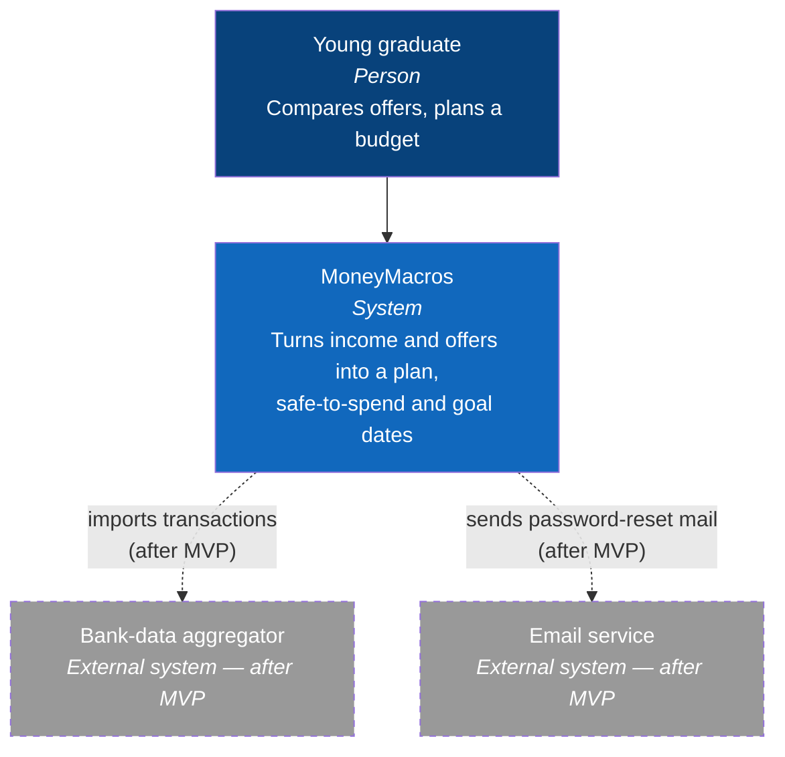
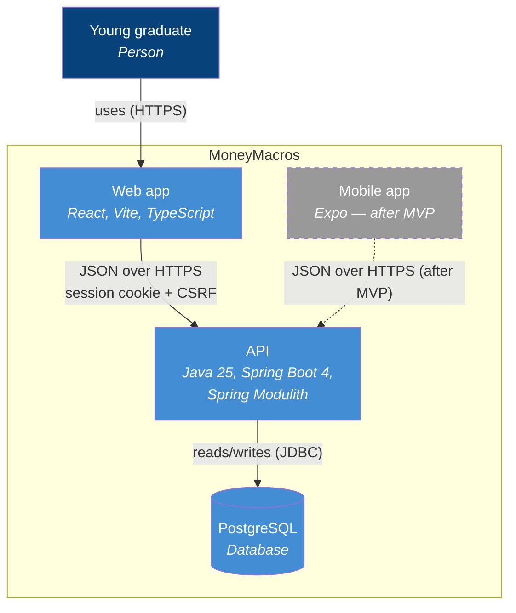
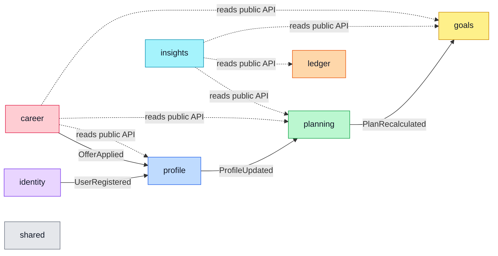
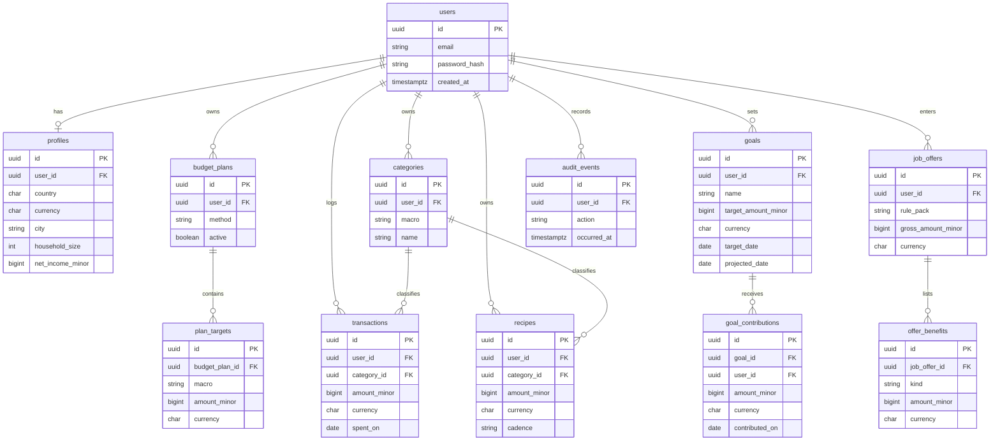
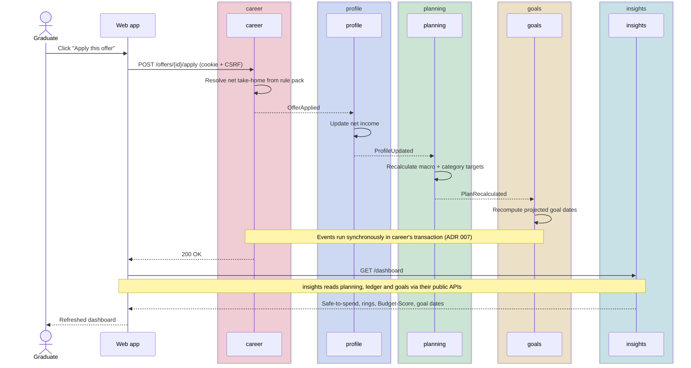

# MoneyMacros — Architecture

This document describes the system through a few complementary views: the C4
**context** and **container** views, the **API module map**, the **data model**
(ERD v1), and one **sequence** for the core flow. Diagrams use Mermaid so they
render on GitHub and in Obsidian. Start with [PRODUCT.md](PRODUCT.md) for scope,
[GLOSSARY.md](GLOSSARY.md) for the vocabulary; decisions live in
[adr/](adr/README.md).

> Mermaid's dedicated C4 syntax is still experimental, so the C4 views below are
> drawn as plain `flowchart` diagrams.

## C4 — System context

Who uses MoneyMacros and which external systems it talks to. The bank-data
aggregator and the email service are **after MVP** (dashed).

## C4 — Containers

The MVP ships the web app, the API and the database. The Expo mobile app is
**after MVP** (dashed).

## API — module map

The API is a modular monolith (Spring Modulith, [ADR 001](adr/001-modular-monolith.md)).
Each module owns its tables and talks to others **only through their public API
or their published events** — never by reaching into another's internals.

> [!IMPORTANT]
> A module may touch another only through its public API or the events it
> publishes. No cross-module table access, no shared internals — this is what
> keeps the monolith decomposable.

Every module may use `shared` (`Money`, `Currency`, error types) — not drawn.

| Module | Owns | Listens to | Publishes |
|--------|------|------------|-----------|
| **identity** | accounts, sessions, audit log | — | `UserRegistered` |
| **profile** | country, currency, city, household, net income | `UserRegistered`, `OfferApplied` | `ProfileUpdated` |
| **planning** | budget method, macro and category targets | `ProfileUpdated` | `PlanRecalculated` |
| **ledger** | expenses, categories, recipes | — | — |
| **goals** | goals, contributions (money set aside for a goal) and projected dates | `PlanRecalculated` | — |
| **career** | rule packs, job offers, comparisons, reverse mode | — | `OfferApplied` |
| **insights** | safe-to-spend and Budget-Score calculations; stores nothing | — | — |
| **shared** | `Money`, `Currency`, error types (no business logic) | — | — |

`career` reads `profile` (household size, for family tax deductions), `planning`
and `goals` through their public APIs to build comparisons and projections; it
changes the plan only by publishing `OfferApplied`. `insights` stores nothing and
listens to nothing: on a dashboard request it reads `planning`, `ledger` and
`goals` and computes safe-to-spend and the Budget-Score on the spot.

## Data model — ERD v1

Every user-owned table carries `user_id`. Money is `amount_minor BIGINT` plus
`currency CHAR(3)` (ISO 4217); see [ADR 002](adr/002-money-minor-units.md).

> [!WARNING]
> Money is never a `double`. Store integer minor units + an ISO 4217 currency,
> and compute with `BigDecimal`. Floating point silently loses precision on
> money.

Spring Session's tables come from the library, not from a module, so they are
not drawn here.

## Sequence — apply an offer to my plan

From the click to the refreshed dashboard. Events fan out from `career` through
`profile`, `planning` and `goals`; `insights` is read on demand for the dashboard.

> [!IMPORTANT]
> Module events are handled **synchronously, in the publisher's transaction**
> (see [ADR 007](adr/007-synchronous-module-events.md)). The whole fan-out
> commits or rolls back together, so the dashboard is current the moment the
> apply call returns.

