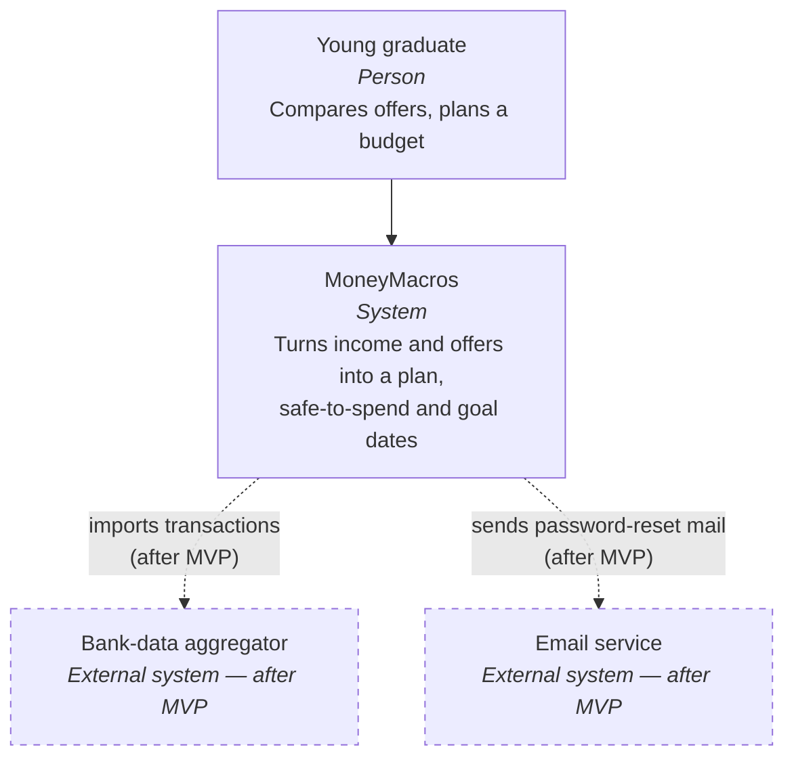
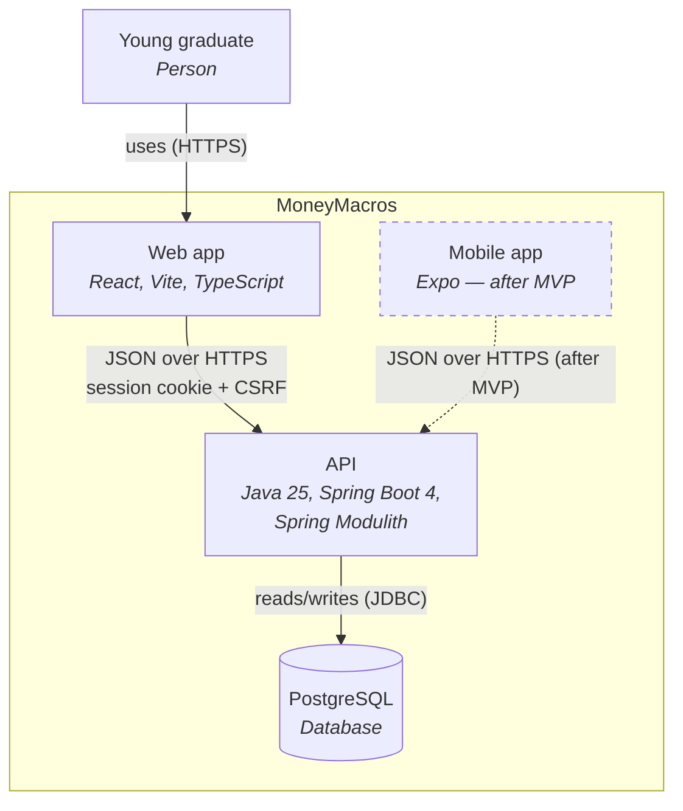
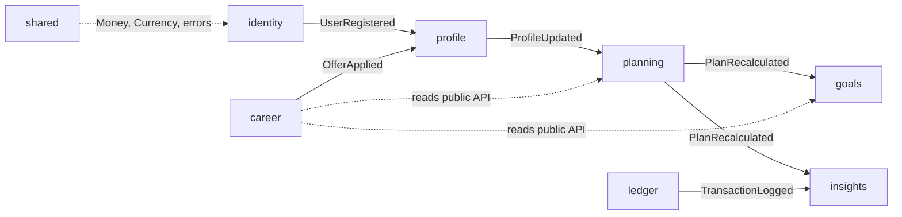
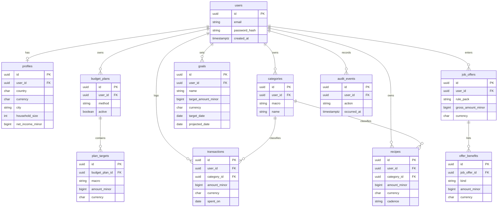
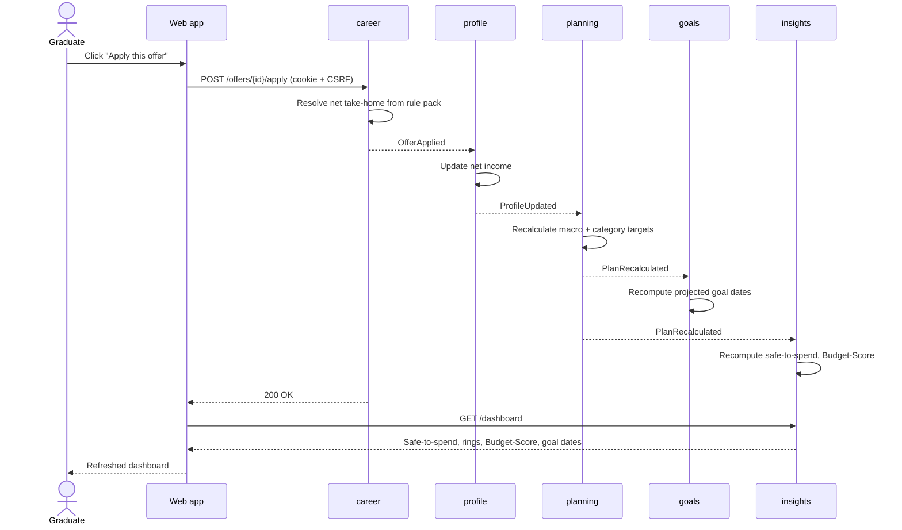

# MoneyMacros — Architecture

This document describes the system at three levels: the C4 **context** and
**container** views, the **API module map**, the **data model** (ERD v1), and
one **sequence** for the core flow. Diagrams use Mermaid so they render on
GitHub and in Obsidian. Start with [PRODUCT.md](PRODUCT.md) for scope and
[GLOSSARY.md](GLOSSARY.md) for the nutrition → money vocabulary; design
decisions live in [adr/](adr/README.md).

> Mermaid's dedicated C4 syntax is still experimental, so the C4 views below are
> drawn as plain `flowchart` diagrams.

## C4 — System context

Who uses MoneyMacros and which external systems it talks to. The bank-data
aggregator and the email service are **after MVP** (dashed).

## C4 — Containers

The MVP ships the web app, the API and the database. The Expo mobile app is
**after MVP** (dashed).

## API — module map

The API is a modular monolith (Spring Modulith, see
[ADR 001](adr/001-modular-monolith.md)). Each module owns its tables and talks
to other modules **only through their public API or their published events** —
never by reaching into another module's internals.

| Module | Owns | Listens to | Publishes |
|--------|------|------------|-----------|
| **identity** | accounts, sessions, audit log | — | `UserRegistered` |
| **profile** | country, currency, city, household, net income | `UserRegistered`, `OfferApplied` | `ProfileUpdated` |
| **planning** | budget method, macro and category targets | `ProfileUpdated` | `PlanRecalculated` |
| **ledger** | expenses, categories, recipes | — | `TransactionLogged` |
| **goals** | goals and projected dates | `PlanRecalculated` | — |
| **career** | rule packs, job offers, comparisons, reverse mode | — | `OfferApplied` |
| **insights** | safe-to-spend, Budget-Score | `TransactionLogged`, `PlanRecalculated` | — |
| **shared** | `Money`, `Currency`, error types (no business logic) | — | — |

`career` reads `planning` and `goals` through their public APIs to build
comparisons and projections; it changes the plan only indirectly, by publishing
`OfferApplied`.

## Data model — ERD v1

Every user-owned table carries `user_id`. Money is stored as
`amount_minor BIGINT` (minor units, e.g. centimes) plus `currency CHAR(3)`
(ISO 4217); see [ADR 002](adr/002-money-minor-units.md).

The session and event-publication tables are created by Spring Session and
Spring Modulith, so they are not drawn here.

## Sequence — apply an offer to my plan

From the click in the web app to the refreshed dashboard. Spring Modulith
events fan out from `career` through `profile`, `planning`, `goals` and
`insights`.

