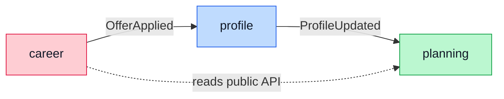

[← Start here](<Start here.md>)

> [!abstract] In one sentence
> A modular monolith is one deployable app split into modules with hard
> boundaries, so the code stays organized like microservices without the network
> and ops cost.

## The picture

## How it works

1. Each module owns its own tables and its own logic.
2. A module exposes a small **public API**; everything else is internal.
3. Modules talk only through that public API or through **events** they publish.
4. Spring Modulith verifies these boundaries in a test, so a sneaky import
   across modules fails the build.
5. It all ships as one process, one database, one deploy.

## In MoneyMacros

- The module map and boundary rule: [ARCHITECTURE.md](../ARCHITECTURE.md).
- The decision and its trade-offs: [ADR 001](../adr/001-modular-monolith.md).

> [!example] Analogy
> One kitchen, clearly separated stations (prep, grill, pastry). Each station
> owns its tools; they pass plates through the pass, not by grabbing into each
> other's drawers.

> [!warning] Common mistake
> Reaching into another module's tables or internal classes "just this once."
> That quietly welds two modules together and defeats the whole point.

## Check yourself

> [!question]- Why not microservices for the MVP?
> They add network calls, multiple deploys and distributed-data headaches that a
> solo MVP cannot justify; the boundaries can be drawn just as cleanly in one
> process.
	
> [!question]- How can one module use another?
> Only through its public API or the events it publishes — never its internal
> tables or classes.

> [!question]- What stops boundaries from eroding over time?
> Spring Modulith's architecture test fails the build when a module reaches
> across a boundary.

## In my own words

<!-- written by me, not by Claude -->
It's generally recommended to use modular monolith rather than microservices architecture when dealing with single programmer or small group project, to avoid network and ops cost without much benefit, while still benefiting from the multi-module loose coupling
One module can use another with 2 main ways : 
	- Reading last update's values, for example insights only read last values from ledger,  planning and goals to conclude the remaining balance, there is no need for an event trigger.
	- Event trigger, for example, any change in planning would affect the goal by triggering PlanRecalculated Event.
for the third question I checked the answer and concluded that Spring tests naturally fails if spot eroded boundaries.
In summary, User Register and Career update trigger an Event for the Profile module, Insights Reads last values from Career, Insights Reads from Ledger,  Planning and Goals, Ledger trigger Event, Career Reads from Goals, and Planning Reads from Career, Career Read from Profile, Planning and Goals to propose best convenient careers, and any change in Planning would trigger an Event for Goals.