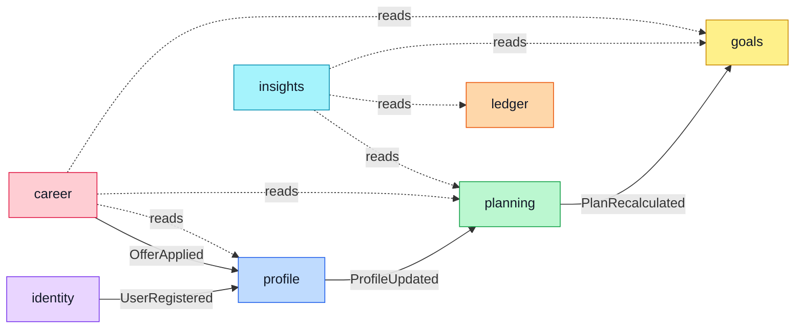
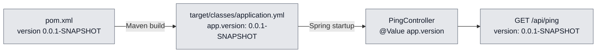
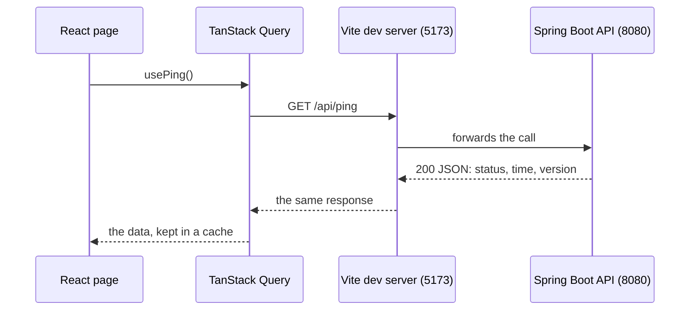
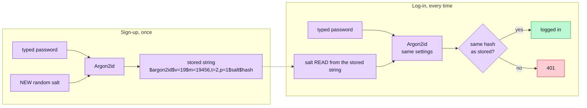
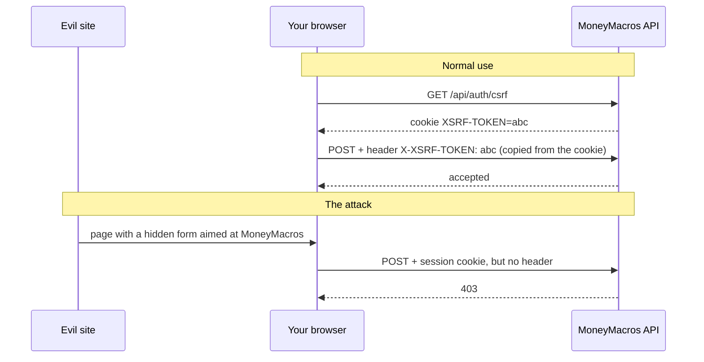

# Learned so far: Days 1–5

A revision sheet for junior interviews. Each part gives the idea in a few lines,
where it lives in MoneyMacros, and a question to test yourself.

> [!TIP]
> Revise like an interview: read the question, answer it out loud, then click it
> to compare. Updated after Day 5 (17 Oct 2026).

## 1. Architecture

### Modular monolith

One app, one deploy, one database, split into **modules with hard boundaries**.
Each module owns its tables. Another module may use it only through its **public
API** (the classes in its top-level package) or the **events** it publishes.
Spring Modulith's `verify()` test (`ModularityTests`) fails the build if a module
reaches into another one's internals.

- **Why not microservices:** they add network calls, several deploys and data
  spread across services, costs a solo MVP can't justify. The boundaries are
  just as clean in one process, and a module can still be split out later.
- **Event or read?** An event says "something changed; others may update their
  own data". A read says "I need the latest numbers now".
- **Events run synchronously, in one transaction** ([ADR 007](adr/007-synchronous-module-events.md)):
  everything updates or nothing does.

Solid arrows are the 4 events, dotted arrows the 6 reads. Every module may also
use `shared` (`Money`, error types). More in [ARCHITECTURE.md](ARCHITECTURE.md)
and [ADR 001](adr/001-modular-monolith.md).

<b>Self-check:</b> a user edits a 45 MAD expense. Which modules change?

Only `ledger`. The next time the dashboard opens, `insights` reads the new total.
No event is needed, because no other module has to update its own data.

## 2. Backend basics

### Dependency injection

An object **receives** what it needs from outside instead of creating it. Spring
creates the objects (called *beans*) and hands each one its dependencies.

- **Why through the constructor:** the dependencies are visible in one place, the
  fields can be `final`, and a test can create the object with `new`, without Spring.
- **In MoneyMacros:** `PingController(@Value("${app.version}") String version)`.

<b>Self-check:</b> what does <code>this.version = version</code> do in that constructor?

`this.version` is the field; plain `version` is the parameter Spring passed in.
The `this.` tells them apart because they share a name.

### Configuration: two kinds of placeholders

| Placeholder | Who replaces it | When | Example |
|---|---|---|---|
| `"@project.version@"` | Maven | at **build** time, when it copies `application.yml` into `target/classes` | `app.version` |
| `${DB_PORT:5432}` | Spring | at **startup** | the database URL |

- `${DB_PORT:5432}` means "use `DB_PORT` if something defines it, otherwise 5432".
- **Profiles:** the `dev` part of `application.yml` applies only when you start
  with `"-Dspring-boot.run.profiles=dev"`. `---` separates the parts (documents).
- **`.env`** holds settings for one machine (yours says `DB_PORT=5433`). It is
  never committed; each computer copies `.env.example`. Docker Compose reads it
  on its own; the API reads it through `spring.config.import`.
- **An environment variable beats every config file:** `$env:DB_PORT = "5433"`
  works for one PowerShell window.

### Database migrations (Flyway)

- Every schema change is a versioned SQL file (`V1__create_users.sql`,
  `V2__spring_session.sql`). Flyway records what already ran in
  `flyway_schema_history` and runs only the new ones.
- **Never edit a migration once it is pushed;** add a new one.
- `ddl-auto: validate`: Hibernate checks that the tables match the code, but never
  changes them.

### Money is never a `double`

A `double` stores numbers in binary. Most decimal fractions, like 0.1, have no
exact binary form (like 1/3 = 0.333… in decimal), so the computer keeps a close
approximation and the errors add up: `0.1 + 0.2` gives `0.30000000000000004`.

- **In MoneyMacros:** `Money(long amountMinor, Currency currency)` stores whole
  centimes in a `long`. Percentages use `BigDecimal` with an explicit
  `RoundingMode` ([ADR 002](adr/002-money-minor-units.md)).
- Build a `BigDecimal` from a String, never from a `double`:
  `new BigDecimal(0.1)` copies the double's error.
- **Scale** = digits written after the point. `12.300` (scale 3) is exactly 12.30,
  so it is accepted; `12.345` cannot be stored in centimes, so it is rejected.
- `Money` may be negative, because a balance can go below zero.
  "An expense must be positive" is a rule of expenses, not of money.

<b>Self-check:</b> why does <code>Money.plus</code> use <code>Math.addExact</code>?

A `long` has a maximum value. A plain `+` past it silently wraps around to a huge
negative number; `addExact` throws an error instead, so a wrong amount can never
pass unnoticed.

### One error format: Problem Details (RFC 9457)

Every error has the same JSON shape: `type`, `title`, `status`, `detail`,
`instance`. Validation errors add an `errors` list, one entry per invalid field.

- A **500** never shows the exception message or a stack trace. The server logs
  the error with a random `errorId` and returns only that id, so a user report
  leads to one log line.
- In MoneyMacros: `GlobalExceptionHandler`, [ADR 008](adr/008-problem-details-errors.md).

## 3. HTTP and the web

### How a request travels

The page and TanStack Query run in your browser, which only ever talks to one
address (5173). Vite forwards the `/api` calls to the API on 8080, so there is no
CORS to configure.

### Status codes you have seen

| Code | Meaning | Example in MoneyMacros |
|---|---|---|
| 200 OK | success, with a body | `GET /api/me` |
| 201 Created | something was created | `POST /api/auth/signup` |
| 204 No Content | success, no body | `POST /api/auth/logout` |
| 400 Bad Request | the input is invalid | a sign-up with a short password |
| 401 Unauthorized | not logged in, or wrong credentials | `GET /api/me` after logout |
| 403 Forbidden | the server refuses this request | a POST without the CSRF token |
| 404 Not Found | no such address | `/api/does-not-exist` |
| 409 Conflict | it clashes with existing data | a sign-up with an email already used |
| 500 Internal Server Error | a bug on the server | answers with an `errorId` only |

> [!NOTE]
> 401 asks "who are you?"; 403 says "I know the request, and I refuse it".

### TypeScript interface

An interface describes the **shape** of data, for example the JSON that
`/api/ping` returns. TypeScript checks the code against it during the build; it
does not exist when the app runs. Later these types are generated from the API's
contract ([ADR 005](adr/005-openapi-contract.md)).

## 4. Security

### Storing passwords

1. **Never store the password,** only a one-way hash.
2. **A hash is deterministic,** so the input mixes in a **salt**: random bytes
   drawn for each password. The same password gives different hashes, and
   precomputed lists of common-password hashes become useless.
3. **A slow, memory-hard algorithm:** Argon2id costs 19 MiB and 2 passes per
   guess, which makes guessing expensive. Never plain SHA-256 or MD5 for passwords.
4. **The stored string carries everything:** algorithm, version, settings, salt
   and hash. At login, the app hashes the typed password with the stored salt and
   compares the results.

In MoneyMacros: `Argon2PasswordEncoder(16, 32, 1, 19456, 2)` in `SecurityConfig`,
checked by Spring Security's `DaoAuthenticationProvider`. You saw it yourself: two
accounts with the same password have two different hashes in the `users` table.

### The same answer for a wrong password and an unknown email

- Two different messages would let anyone test which emails have an account.
- **Timing attack:** checking a real password with Argon2id takes tens of
  milliseconds; rejecting an unknown email could be instant, and the response
  time would give it away. `DaoAuthenticationProvider` hashes a dummy password
  for unknown emails too.

### Sessions and cookies

- **Server-side session:** the server remembers who you are (Spring Session's
  tables in PostgreSQL). The browser only keeps a random id in the `SESSION` cookie.
- **HttpOnly:** JavaScript can't read the cookie, so an XSS bug can't steal it.
  **SameSite=Lax:** the browser doesn't send it on most requests started by
  other sites.
- **Session fixation:** the session id changes at login, so an id an attacker
  planted before login becomes useless.
- **Logout** deletes the session on the server; the old cookie then means nothing.
- Why not a JWT in browser storage: JavaScript could read it ([ADR 003](adr/003-server-side-sessions.md)).

### CSRF (cross-site request forgery)

The attack: another site makes your browser send a request to MoneyMacros, and
the browser adds your session cookie automatically. The defence: the web app
copies the `XSRF-TOKEN` cookie into a header. Other sites cannot read your
cookies, so they cannot copy the token, and their request gets a 403.

### Check-then-act race condition

"Does this email exist? No, so insert it": two sign-ups at the same moment can
both pass the question before either inserts. The database's **unique
constraint** is the real guard; its error must become a 409. (The fix comes at
the start of Day 6.)

## 5. Testing

| Kind | What starts | Speed | In MoneyMacros |
|---|---|---|---|
| Unit | only the class | milliseconds | `MoneyTest` |
| Slice | one layer of Spring (web) | about a second | `PingControllerTest` (`@WebMvcTest`) |
| Integration | the whole app plus a real PostgreSQL in Docker | seconds | `AuthIntegrationTest` (`@IntegrationTest`, Testcontainers) |

- Every test has three parts: **Arrange** (prepare), **Act** (do one thing),
  **Assert** (check the result).
- **Make a test fail once:** a test you have never seen fail may be testing nothing.
- **Control the inputs:** `properties = "app.version=1.2.3"`, then expect exactly
  `1.2.3`, so the test never depends on the real version.
- **Testcontainers** runs the real PostgreSQL 18, never an in-memory stand-in
  like H2, so tests run on what production runs ([ADR 006](adr/006-postgres-only.md)).

## 6. Tools and workflow

### Git

- **Conventional Commits:** `feat:`, `fix:`, `docs:`, `test:`, `chore:`, `ci:`.
- `.gitignore` keeps `.env`, build output, `node_modules/` and `docs/private/`
  out of the repo.
- Anything pushed stays in the history. For notes that's fine; a pushed secret
  (a password, a key) must be changed, because deleting the file doesn't remove it.
- From Day 6: one branch per day and a pull request, merged once CI passes.

### CI (GitHub Actions)

- Every push runs `ci.yml`: the **api** job (`./mvnw verify`) and the **web** job
  (`npm ci`, lint, build). Green means it builds and passes its tests on a clean
  machine, not only on yours.
- Each `uses:` line runs a ready-made action at a version tag. Old majors that
  ran on Node.js 20 were deprecated, so the workflow moved to `checkout` v7,
  `setup-java` v6 and `setup-node` v7.

### Docker Compose

- `docker-compose.yml` starts PostgreSQL 18 in a container.
- `docker compose ps` shows the port mapping `0.0.0.0:5433->5432/tcp`: port 5433
  on your PC leads to port 5432 inside the container.
- The data lives in a named volume, so recreating the container keeps it;
  `docker compose down -v` deletes it.

### Reading errors

- **Compiler:** read the first `[ERROR]` line. It gives the file, the line and the
  reason: `cannot find symbol: class string` means `String` needs a capital S.
- `BUILD SUCCESS` after `spring-boot:run` only means Maven finished. Look for
  `Started ApiApplication` or `Application run failed`.
- **Follow the first error:** the ones after it are often its consequences.

## 7. Algorithms (side learning)

### Hashing: two families

| | Hash-table hash | Cryptographic or password hash |
|---|---|---|
| Goal | spread keys across buckets, fast | impossible to reverse or to forge |
| Examples | `String.hashCode()`, `HashMap` | SHA-256; Argon2id or bcrypt for passwords |
| Collisions | expected, handled by **chaining** (a list per bucket) | must be practically impossible to find |
| Speed | as fast as possible | fast (SHA-256) or slow on purpose (Argon2id) |

- `HashMap` lookup is **O(1) on average**. When many keys collide in one bucket
  it gets slower: O(n), or O(log n) once Java turns a big bucket into a tree.
- A real collision: `"Aa".hashCode()` and `"BB".hashCode()` are both 2112.

### Two Sum

Find the two positions whose numbers add up to `target`.

- **Brute force:** try every pair, so O(n²).
- **Watch out:** the two numbers can be anywhere in the array, not only next to
  each other.

<b>Self-check:</b> how does a <code>HashMap</code> bring it down to O(n)?

For each number `x`, the partner you need is `target − x` (the *complement*).
Keep a map of the numbers already seen (value → index). If the complement is in
the map, you have the answer; otherwise store `x` and move on. One pass: O(n) time,
O(n) memory.

### Java 25 compact source files

`void main() { IO.println("Hi"); }` runs without declaring a class (JEP 512), and
the `java.base` classes are imported automatically. Handy for small experiments.

## 8. Interview bank: questions so far

Write your own answers in `docs/private/interview-bank.md`; these are the points
each answer should cover.

| Day | Question | Points to cover |
|---|---|---|
| 1 | Present your project in 60 seconds. | the problem (graduates can't see what an offer means for their budget), what the app does, the stack, one choice you're proud of |
| 2 | Monolith or microservices, and why? | one deploy, modules with hard boundaries, checked by a test; microservices' cost for a solo MVP; a module can be split out later |
| 3 | What is dependency injection, and why the constructor? | objects receive their dependencies; Spring creates and passes them; visible, `final`, testable without Spring; `PingController` |
| 4 | Why is money never stored as a `double`? | binary floating point, `0.1 + 0.2`; errors add up; `long` minor units, `BigDecimal` from Strings, explicit rounding; `Money`, ADR 002 |
| 5 | How do you store passwords safely? | never the password; a salt per password; a slow algorithm (Argon2id); how login checks it; same error for unknown emails |
| any | How did you use AI on this project? | Claude Code wrote code from prompts you prepared; you designed it (ADRs), reviewed every change, ran the checks, fixed what failed, and can explain every part |

## 9. Problems you solved (STAR material)

STAR = Situation, Task, Action, Result: the shape interviewers expect for "tell
me about a problem you solved".

| Situation | Action | Result and lesson |
|---|---|---|
| The login check failed with a French "password authentication failed" error. | Read the error, saw it came from your PC's own PostgreSQL, checked `.env` and `docker compose ps`: two servers shared port 5432 and `.env` was missing. Moved Docker to 5433. | All four checks passed. Read the first real error, and check *which* server answers. |
| The generator added a database table that nothing used. | Saw it served async events, which ADR 007 rules out, and removed it. | A smaller, explainable schema. Don't ship what you can't explain. |
| Code comments pointed to rule files that didn't exist. | Checked the folder and had the files created from the ADRs. | References that resolve. Verify what a tool claims it did. |
