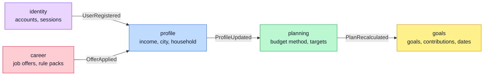
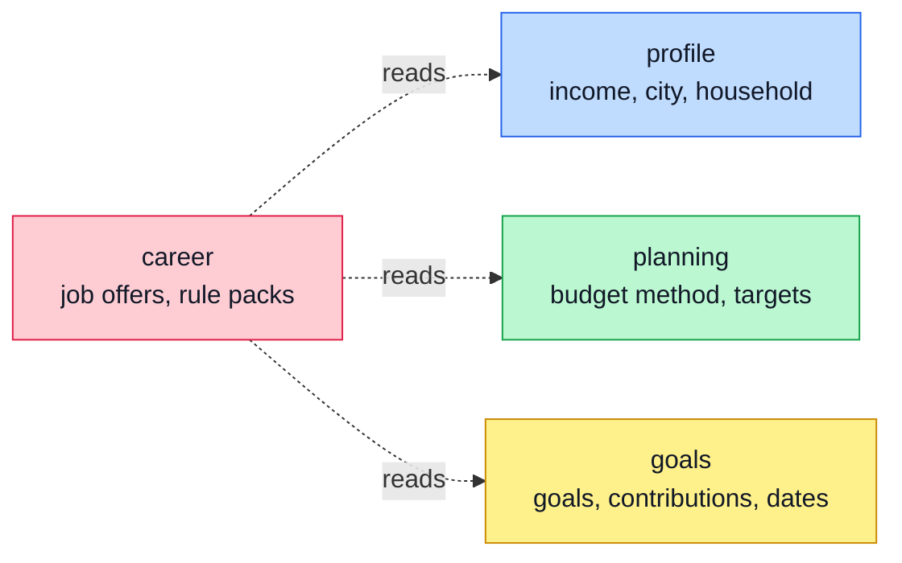
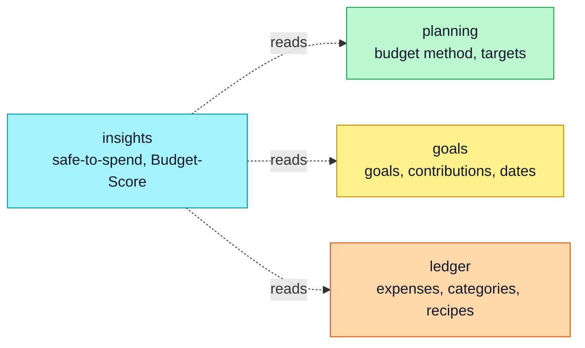
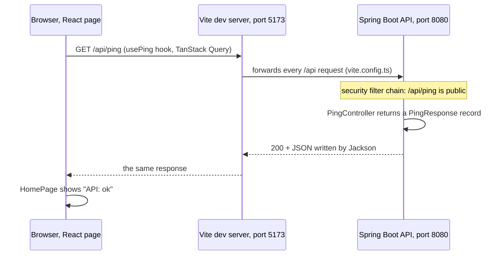
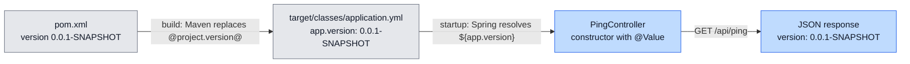
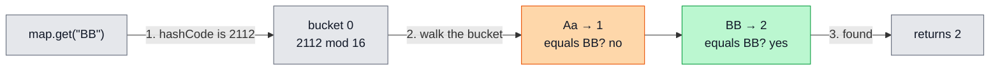
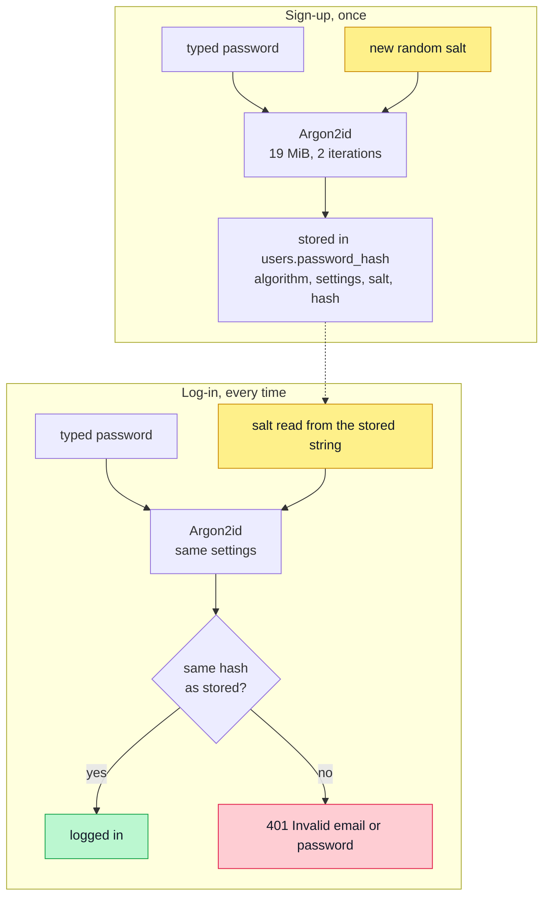
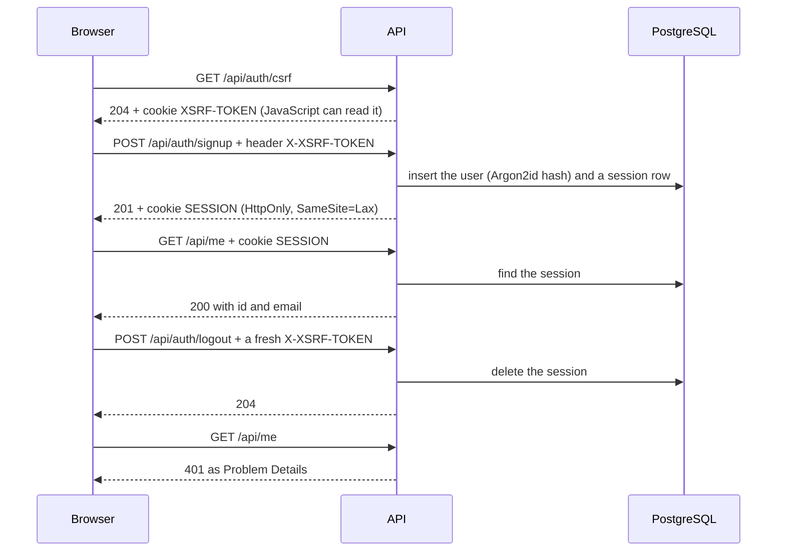
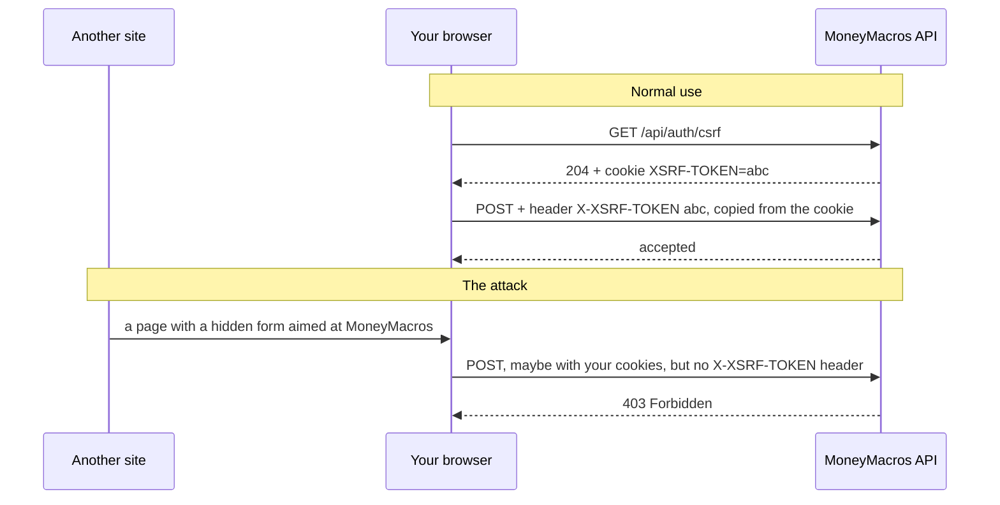
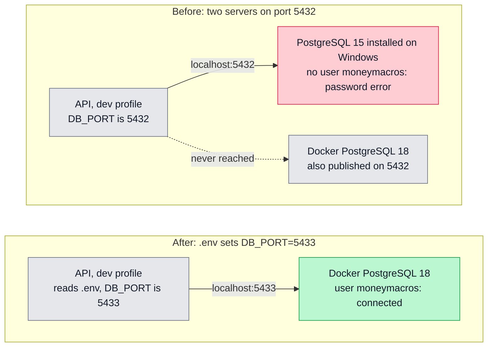

# Learned so far: Days 1 to 5

A study log kept while building MoneyMacros, 13 to 17 October 2026. Each section explains one idea, shows where it lives in the project, then asks questions: click a question to reveal its answer (in Obsidian, switch to Reading view).

> [!TIP]
> Revise like an interview: read a question, answer it out loud, then open it to compare.

## At a glance

| Day | What was built | Ideas to know |
|---|---|---|
| 1 · Tue 13 Oct | Product brief, glossary, rules for Claude Code | Money is never a `double`, HttpOnly cookies, monolith first |
| 2 · Wed 14 Oct | Architecture, module map, ADRs 001 to 007 | C4, ADRs, events vs reads, synchronous events |
| 3 · Thu 15 Oct | Walking skeleton: React → Spring Boot → PostgreSQL, CI | How a request travels, configuration, dependency injection |
| 4 · Fri 16 Oct | `Money` type, one error format, a base for database tests | `BigDecimal` scale, Problem Details, kinds of tests |
| 5 · Sat 17 Oct | Sign-up, log-in, log-out | Salted password hashing, sessions, CSRF, a port clash |

## 1. Architecture: one app, eight modules

**Modular monolith.** MoneyMacros is one Spring Boot application with one database, split into modules that talk only through public APIs or events. A Spring Modulith test (`ModularityTests`) fails the build if a module reaches into another one's internals. Microservices would add network calls, distributed transactions and several deployments, with nothing gained for a one-person project. A module can still be extracted later, because its boundary is clean.

**Two ways to talk.** Ask one question per arrow:

- **Event, A → B:** when A changes, must B's own data change? Then A announces an event, and B updates itself.
- **Read, A → B:** does A need B's numbers to do its job? Then A calls B's public API, and nothing changes.

Events are named in the past tense (`UserRegistered`): a fact that happened, not an order.



Four events form one chain. identity starts it, and career joins it with `OfferApplied`.

Six reads: career and insights each ask three modules.





ledger and insights never send or hear an event. `shared` (`Money`, `Currency`, error types) is a toolbox every module uses, so it has no arrows.

> [!IMPORTANT]
> Module events run **synchronously, inside the publisher's transaction** ([ADR 007](adr/007-synchronous-module-events.md)). When "Apply this offer" returns, profile, plan and goals are all updated, or none is. The cost: one failing listener rolls everything back, and a slow listener slows the whole request.

**Documenting decisions.** The C4 model draws a system at zoom levels: the *context* (who uses it, what it talks to), then the *containers* (web app, API, database). An ADR (Architecture Decision Record) is one page per decision: Title, Status, Context, Decision, Consequences. It's the written answer to "why did you choose X?". The diagrams are in [ARCHITECTURE.md](ARCHITECTURE.md), the decisions in [adr/](adr/README.md).

> [!TIP]
> Every dependency must earn its place. On Day 3, Spring Modulith's event table and three observability modules were removed: nothing used them, and anything in the project can come up in an interview.

### Check yourself

<details>
<summary>Why does ledger send no event when an expense is logged?</summary>
No other module's own data has to change. insights reads ledger's totals the next time the dashboard opens.
</details>

<details>
<summary>Why doesn't career change the plan directly when an offer is applied?</summary>
That would mean writing into another module's data. career announces OfferApplied, and profile and planning update their own data.
</details>

<details>
<summary>Why does insights read on demand instead of listening to events?</summary>
It stores nothing, so it has nothing to update. Reading when the dashboard opens is always up to date, even after an expense is edited or deleted.
</details>

<details>
<summary>What stops a module from using another module's tables?</summary>
The Spring Modulith test (ModularityTests) checks every dependency between modules and fails the build on a violation.
</details>

## 2. How a request travels

**What an API is.** An API is the list of requests a piece of software accepts from outside, and the only way in. MoneyMacros has it at two scales:

- **Module API:** the Java types in a module's top-level package. identity exposes only `AuthenticatedUser` and `UserRegistered`; everything else is internal.
- **HTTP API:** the URLs the web app calls, such as `GET /api/ping` or `POST /api/auth/login`.



In development, the browser only talks to Vite on port 5173, which forwards every `/api/...` request to Spring Boot on 8080. The browser sees a single origin, so there is no CORS to configure.

**TypeScript interface.** `usePing.ts` describes the JSON it expects with `interface Ping { status: string; time: string }`. TypeScript checks the code against it while building, then removes it, so in the browser `as Ping` checks nothing. The API already sends a `version` field that `Ping` doesn't list: it reaches the browser, but the code can't use `data.version` until the interface declares it. Later, these types will be generated from the API's contract ([ADR 005](adr/005-openapi-contract.md)), so the two sides can't drift apart.

**Status codes met so far**

| Code | Meaning | Where |
|---|---|---|
| 200 OK | Success, with a body | `GET /api/me` |
| 201 Created | Something was created | `POST /api/auth/signup` |
| 204 No Content | Success, no body | logout, `GET /api/auth/csrf` |
| 400 Bad Request | Invalid input | validation errors |
| 401 Unauthorized | Not logged in, or wrong credentials | `/api/me` without a session |
| 403 Forbidden | Refused, even when the server knows who you are | a POST without its CSRF token |
| 404 Not Found | No such URL | `/api/does-not-exist` |
| 409 Conflict | Clashes with existing data | an email already in use |
| 500 Internal Server Error | A bug on the server | anything unexpected |

**One error format ([ADR 008](adr/008-problem-details-errors.md)).** Every error is a Problem Detail (RFC 9457) with `type`, `title`, `status`, `detail` and `instance`, sent as `application/problem+json`. A 400 adds an `errors` list of `{field, message}`. A 500 never shows the exception message or a stack trace: it returns an `errorId`, and the same id is written to the server log next to the full error.

### Check yourself

<details>
<summary>Why does the web app call /api/ping and not http://localhost:8080/api/ping?</summary>
Vite forwards /api to the API, so the browser stays on one origin and no CORS setup is needed.
</details>

<details>
<summary>What is the difference between 401 and 403?</summary>
401: the server doesn't know who you are (no session, or wrong credentials). 403: the request is refused anyway, like a POST without its CSRF token.
</details>

<details>
<summary>Why return an errorId instead of the exception message on a 500?</summary>
Messages and stack traces can show internals to an attacker. The errorId lets you find the full error in the log when a user reports it.
</details>

<details>
<summary>Does interface Ping check the JSON when the page runs?</summary>
No. TypeScript uses it only while building, then removes it. "as Ping" is a promise to the compiler, not a check, so a wrong shape only fails later, where the data is used.
</details>

## 3. Configuration and dependency injection

**Where a value comes from.** The version returned by `/api/ping` travels from `pom.xml` to the JSON:



Two kinds of placeholder, at two moments:

- `"@project.version@"` is replaced by **Maven, at build time** (resource filtering), in the copy of `application.yml` under `target/classes`.
- `${app.version}` is resolved by **Spring, at startup**. `${DB_PORT:5432}` means "the value of DB_PORT if one is defined, otherwise 5432". When a placeholder has no value and no default, the app refuses to start rather than run with a wrong value.

**YAML.** Indentation is structure. `---` starts a new document; a document with `spring.config.activate.on-profile: dev` applies only to the dev profile. A value that starts with `@` needs quotes.

**`.env`.** Docker Compose reads `.env` automatically; Spring Boot doesn't, so the dev profile imports it with `spring.config.import: "optional:file:../.env[.properties]"`. The file is git-ignored: it's specific to each machine (`DB_PORT=5433` where 5432 is taken) and will later hold secrets. Each machine creates its own from `.env.example`.

**Dependency injection.** An object receives the things it needs instead of creating them. Spring creates the objects (beans) and passes each one its dependencies, usually through the constructor:

```java
public PingController(@Value("${app.version}") String version) {
    this.version = version;   // this.version is the field, version the parameter
}
```

Through the constructor, the dependencies are visible in one place, the field can be `final`, and a test can build the object with `new PingController("1.2.3")` without starting Spring.

### Check yourself

<details>
<summary>What is the difference between @project.version@ and ${app.version}?</summary>
Maven replaces the first while building the project. Spring resolves the second when the app starts.
</details>

<details>
<summary>Why did the API ignore .env on Day 3?</summary>
Spring Boot doesn't read .env files; only Docker Compose does. The dev profile now imports the file explicitly.
</details>

<details>
<summary>Why inject through the constructor rather than into a field?</summary>
The dependencies are visible in one place, the fields can be final, and the class can be created in a plain test without Spring.
</details>

## 4. Money and numbers

**Why never a `double`.** A `double` stores numbers in binary, and most decimal fractions have no exact binary form, the way 1/3 has none in decimal. So `0.1 + 0.2` gives `0.30000000000000004` and `1.0 - 0.9` gives `0.09999999999999998`. Tiny errors add up, and money must be exact.

**The rule ([ADR 002](adr/002-money-minor-units.md)).** Store a `long` count of minor units plus an ISO 4217 currency: 12.30 MAD is `1230` and `MAD`. Calculate with `BigDecimal` built from Strings, and round only with an explicit `RoundingMode`.

| Expression | Result | Lesson |
|---|---|---|
| `new BigDecimal("1.0").subtract(new BigDecimal("0.9"))` | `0.1` | Exact |
| `new BigDecimal(0.1)` | `0.1000000000000000055511151231257827021181583404541015625` | Built from a `double`, it copies the error: use a String |
| `new BigDecimal("1.0").equals(new BigDecimal("1.00"))` | `false` | `equals` also compares the number of decimals |
| `new BigDecimal("1.0").compareTo(new BigDecimal("1.00"))` | `0` | `compareTo` compares the value: use it for amounts |

**Scale.** A `BigDecimal`'s scale is how many digits are *written* after the point. `12.300` has scale 3 but is exactly 12.30 MAD, so `Money.of` accepts it. `12.345` can't fit in 2 decimals without losing value, so it's rejected. `setScale(2, RoundingMode.UNNECESSARY)` means "go to 2 decimals only if nothing is lost, otherwise fail".

In the code, [`Money`](https://github.com/ilyas8888/moneymacros/blob/main/api/src/main/java/com/moneymacros/shared/Money.java) refuses to add two currencies, and `Math.addExact` throws on overflow instead of silently wrapping around. `Money` may be negative, because a balance can go below zero: "an expense must be positive" is a rule of expenses, not of money.

### Check yourself

<details>
<summary>Why is 12.300 MAD accepted but 12.345 MAD rejected?</summary>
12.300 is exactly 12.30, so nothing is lost at 2 decimals. 12.345 would need rounding, and Money refuses to round silently.
</details>

<details>
<summary>1.0 and 1.00 as BigDecimals in a HashSet: how many elements?</summary>
Two. equals and hashCode include the scale, so the set sees two different keys. Compare amounts with compareTo.
</details>

<details>
<summary>Why build a BigDecimal from "0.1" rather than from 0.1?</summary>
The double 0.1 is already slightly wrong, and new BigDecimal(0.1) copies that error exactly.
</details>

<details>
<summary>Why does Money.plus use Math.addExact instead of +?</summary>
A long has a maximum value. Past it, + silently wraps around to a huge negative number, while Math.addExact throws an ArithmeticException, so a wrong amount can't pass unnoticed.
</details>

## 5. Hashing: two families

The same word covers two different tools:

| | HashMap hashing (`hashCode()`) | Password hashing (Argon2id) |
|---|---|---|
| Goal | Find a key fast | Make guessing too expensive |
| Speed | As fast as possible | Slow and memory-hungry on purpose |
| Collisions | Normal, handled inside buckets | Must be practically impossible to find |
| Salt | No | A random one for each password |

**HashMap.** `hashCode()` turns a key into a number, which picks a bucket. Collisions can't be avoided, because there are far more possible keys than hash values. `"Aa"` and `"BB"` both give 2112, since Java computes a String's hash as `h = 31 * h + character`: 65 × 31 + 97 and 66 × 31 + 66. Inside a bucket, `equals()` finds the right key:



- A lookup is O(1) on average. The worst case, when everything collides, is O(n), or O(log n) since Java 8, where a crowded bucket becomes a tree.
- At 75% full (the load factor), the table doubles and every key moves to its new bucket.
- The contract: if `a.equals(b)`, then `a.hashCode() == b.hashCode()`. Break it and the map "loses" keys.

**Passwords.** Never store the password, only a one-way hash. A hash is deterministic (same input, same output), so the input is the password plus a **salt**: random bytes drawn at each sign-up. Two users with the same password get different hashes, and precomputed tables of common-password hashes become useless. Fast hashes like SHA-256 or MD5 are the wrong tool, because an attacker can try billions of guesses per second. Argon2id at OWASP's minimum settings (19 MiB of memory, 2 iterations, parallelism 1) makes every guess expensive. In the code, that's `new Argon2PasswordEncoder(16, 32, 1, 19456, 2)` in `SecurityConfig`: a 16-byte salt, a 32-byte hash, then parallelism, memory in KiB and iterations. The stored string carries everything needed to check a password later:

```text
$argon2id$v=19$m=19456,t=2,p=1$<salt>$<hash>
 │        │    │               │      └ the result
 │        │    │               └ random bytes (the salt)
 │        │    └ settings: memory, iterations, parallelism
 │        └ version
 └ algorithm
```



### Check yourself

<details>
<summary>Why do two accounts with the same password have different hashes?</summary>
Each sign-up draws a new random salt, and the hash input is the password plus the salt.
</details>

<details>
<summary>How does log-in check a password that was never stored?</summary>
It reads the salt and settings from the stored string, hashes the typed password with them, and compares the result with the stored hash.
</details>

<details>
<summary>"Aa" and "BB" share a hashCode. How does map.get("BB") still return the right value?</summary>
Both land in the same bucket, and HashMap compares the keys inside it with equals().
</details>

<details>
<summary>Why is slowness a feature for password hashing but a bug for a HashMap?</summary>
An attacker tries billions of password guesses, so each one should be expensive. The app uses a HashMap millions of times itself, so it must be fast.
</details>

## 6. Log-in security: sessions, cookies and CSRF



- **Server-side session ([ADR 003](adr/003-server-side-sessions.md)).** The server remembers who is logged in, in PostgreSQL (table `spring_session`, managed by Spring Session). The browser only holds a random session ID in a cookie. Logging out deletes the session at once, which a JWT stored in the browser can't offer before it expires.
- **HttpOnly.** JavaScript can't read the session cookie, so an XSS bug can't steal it. XSS itself is blocked by React escaping what it displays (and a Content Security Policy on Day 23). SQL injection is blocked by parameterized queries, which Spring Data JPA uses.
- **CSRF.** Another site can make your browser send a request to our API, and the browser attaches our cookies automatically. So every POST must also carry a token only our own page can read: the `XSRF-TOKEN` cookie, copied into the `X-XSRF-TOKEN` header. Another site can't read our cookies, so it can't copy the token (the attack is drawn below). `SameSite=Lax` on the session cookie is a second barrier: browsers leave it off most requests started by other sites.
- **Session fixation.** An attacker plants a session ID before you log in, then reuses it once you're logged in. Changing the ID at log-in makes the planted one useless.
- **User enumeration and timing.** A wrong password and an unknown email get the same `401 Invalid email or password`. Spring Security also hashes a dummy password for unknown emails, so the response time doesn't give them away.
- **Check-then-act race.** "Does this email exist? No, so insert it" lets two simultaneous sign-ups both pass the check. The database's unique constraint is the real guard; the Day 6 fix turns its error into the 409.
- **Not OAuth2.** OAuth2 hands log-in to another provider ("Sign in with Google"). MoneyMacros checks the password itself.

**The CSRF attack, step by step.** Our page copies the token from the cookie into a header. The other site's forged request arrives without it:



> [!NOTE]
> Emails are lower-cased with `Locale.ROOT`. In a Turkish locale, `"I".toLowerCase()` gives a dotless `ı`, so one email could become two different accounts.

### Check yourself

<details>
<summary>Why must the XSRF-TOKEN cookie be readable by JavaScript, while the session cookie must not?</summary>
Our page has to read the token to copy it into a header. The session ID must never be reachable by a script.
</details>

<details>
<summary>Why give the same 401 for a wrong password and an unknown email?</summary>
Different answers would let anyone test which emails have an account.
</details>

<details>
<summary>What is session fixation, and how is it blocked?</summary>
An attacker makes you log in with a session ID they already know. The app changes the session ID at log-in, so the known one stops working.
</details>

<details>
<summary>Why can two sign-ups with the same email both pass the "does it exist?" check?</summary>
Both can ask before either one inserts. Only the database's unique constraint checks and inserts in one step, so it has to be the real guard.
</details>

## 7. Testing

| Kind | What runs | Example | Docker? |
|---|---|---|---|
| Unit | One class, no Spring | `MoneyTest` | No, it takes milliseconds |
| Slice | The web layer for one controller | `PingControllerTest` (`@WebMvcTest`) | No |
| Integration | The whole app and a real PostgreSQL 18 | `AuthIntegrationTest` (`@IntegrationTest`) | Yes, through Testcontainers |

- Every test has three parts: **Arrange** the data, **Act** once, **Assert** the result.
- Use your own test values: `PingControllerTest` sets `app.version=1.2.3`, so it checks the controller's job, not the build's.
- Make a new test fail once on purpose. A test you've never seen fail may not test anything.
- Testcontainers starts a real PostgreSQL 18 in Docker, never an in-memory stand-in like H2, so tests run on the same database as production.
- All database tests share one Spring context and one PostgreSQL container, so the suite starts the database once.
- Run `.\mvnw verify` before pushing, so you see a failing test before CI does (section 8).

### Check yourself

<details>
<summary>Why does MoneyTest run without Docker but AuthIntegrationTest doesn't?</summary>
MoneyTest checks one class in memory. AuthIntegrationTest starts the whole app against a real PostgreSQL, which Testcontainers runs in Docker.
</details>

<details>
<summary>Why does PingControllerTest expect 1.2.3 and not the real version?</summary>
The real version changes with every release. A fixed test value proves the controller returns whatever it's given.
</details>

## 8. Tools and debugging

**The port clash of Day 5.** The API failed with a French "password authentication failed". The message came from the PostgreSQL installed on Windows, not from Docker's:



Habits from these five days:

- **Logs:** `BUILD SUCCESS` only means Maven finished. Search for `Application run failed`, then read the last `Caused by`.
- **Compile errors:** read the first `[ERROR]`. It gives the file, the `[line,column]` and the reason. "cannot find symbol" means Java doesn't know a name: a typo (`string` for `String`) or a missing import.
- **Flyway:** every schema change is a new migration (`V1__create_users.sql`, then `V2__spring_session.sql`), never an edit to one already applied. Flyway lists what already ran in its `flyway_schema_history` table and runs only the new files. It refuses to start when an applied migration is missing, so deleting one means resetting the local database (`docker compose down -v`). Hibernate only checks that the tables match the code (`ddl-auto: validate`) and never changes them.
- **Docker:** `docker compose up -d` starts the database. `docker compose ps` shows the port mapping, such as `0.0.0.0:5433->5432/tcp`: port 5433 on your PC leads to port 5432 inside the container, and `DB_PORT` in `.env` sets the first number. The data lives in the named volume `moneymacros_pgdata`, so recreating the container keeps it, and `docker compose down -v` deletes it. postgres:18 keeps its data in `/var/lib/postgresql/18/docker`, so the volume is mounted at `/var/lib/postgresql`.
- **Git:** Conventional Commits (`feat:`, `fix:`, `docs:`, `test:`, `chore:`, `ci:`), the GitHub noreply email, no logs or "try" commits in the public repo, and a compile before every push. Anything pushed stays in the history, so a pushed secret must be changed: deleting the file doesn't remove it. From Day 6, one branch and one pull request per day.
- **CI:** on every push and pull request, GitHub Actions runs two jobs: `api` (`./mvnw -B verify`, every test) and `web` (`npm ci`, lint, build). Green means the project builds and passes its tests on a clean machine, not only on yours.
- **Windows:** `.\mvnw`, quotes around `-D` arguments in PowerShell, `mvnw` marked executable for the Linux CI, and CRLF line endings kept for `.cmd` and `.bat` files.
- **Claude Code:** start it from the repo root so `CLAUDE.md` loads. Rules in `.claude/rules/` load only for the files they cover. Read its plan before saying OK.

### Check yourself

<details>
<summary>The log ends with BUILD SUCCESS, but the app isn't running. How can both be true?</summary>
Maven finished its own job, which was launching the app. The app then failed during startup: the real error is higher up, after "Application run failed".
</details>

<details>
<summary>Why did a password error mean "wrong database" on Day 5?</summary>
Two PostgreSQL servers listened on port 5432, and localhost reached the one installed on Windows, which has no moneymacros user. DB_PORT=5433 in .env sends the API to Docker's.
</details>

<details>
<summary>Why never edit a migration that has already run?</summary>
Flyway records each applied migration with a checksum. A changed or missing one fails validation, and other databases would end up with a different schema.
</details>

## 9. Algorithms

- **Big-O** describes how time or memory grows with the input size n. With 5 times more data, an O(n) loop takes about 5 times longer, and an O(n²) loop about 25 times.
- **Two Sum, brute force:** try every pair with two nested loops, `j` starting at `i + 1` so an element is never paired with itself. O(n²) time, O(1) extra space. Loop over positions (`nums[i]` is the value), compare `nums[i] + nums[j]` with the target, and return positions, not values.
- **Still open, the O(n) version:** the partner of `nums[i]` is always `target - nums[i]`, and it can be any number already walked past. Next step: fill the table (number, partner needed, in memory?, memory after) for `[2, 7, 11, 15]` with target 9, remembering each number with its position.

> [!TIP]
> To try an algorithm without a project, Java 25 runs a single file with no class around it ([JEP 512](https://openjdk.org/jeps/512)). Write `void main() { IO.println("Hi"); }` in `TwoSum.java` and run `java TwoSum.java`. Classes like `HashMap` and `List` need no import.

### Check yourself

<details>
<summary>Why does j start at i + 1 in the brute force?</summary>
So an element is never added to itself, and each pair is checked only once.
</details>

<details>
<summary>What is the brute force's time complexity, and why?</summary>
O(n²): for each of the n numbers, it scans the rest of the array.
</details>

## 10. Interview bank so far

Write your own version of each answer in `docs/private/interview-bank.md`, in 3 to 5 sentences.

| Day | Question | A good answer covers |
|---|---|---|
| 1 | Present your project in 60 seconds. | What it does and for whom; what's different (it links the budget to job offers); the stack in one line |
| 2 | Monolith or microservices for this project, and why? | One developer, one deployable; what microservices would cost; boundaries enforced by a test; a module can be extracted later |
| 3 | What is dependency injection, and why through the constructor? | Objects receive their dependencies and Spring wires them; visible dependencies, `final` fields, easy tests; `PingController` and `@Value` |
| 4 | Why is money never stored as a `double`? | Binary can't hold most decimal fractions (`0.1 + 0.2`); errors add up; minor units in a `long` and `BigDecimal` built from Strings; `Money` and ADR 002 |
| 5 | How do you store passwords safely? | Never the password; a random salt for each one; a slow, memory-hard algorithm (Argon2id); log-in re-hashes with the stored salt; the same error for a wrong password and an unknown email |
| Any | How did you use AI on this project? | Claude Code wrote code from prompts you prepared; you made the design decisions (the ADRs), reviewed every change, ran the checks, fixed what failed, and can explain each part |

## 11. Problems you solved

"Tell me about a problem you solved" is a classic interview question. Answer it with **STAR**: the Situation, your Task, the Action you took, and the Result. The last two stories also answer "How did you use AI?": you checked what the tool produced.

**The wrong database (Day 5)**

- **Situation and task:** the API had to start for the log-in check, but PostgreSQL rejected the password, in French.
- **Action:** read the first real error and saw it came from the PostgreSQL installed on Windows, not Docker's. `docker compose ps` and `.env` showed why: both servers used port 5432, and `.env` was missing. Set `DB_PORT=5433` in `.env` (section 8).
- **Result:** the API reached Docker's database and the manual check passed. Lesson: check *which* server answers, not only what it says.

**A table nothing used (Day 3)**

- **Situation and task:** the generated backend created an `event_publication` table, and every part of the project had to be explainable.
- **Action:** found that it stores events for delivery later, in the background, which [ADR 007](adr/007-synchronous-module-events.md) rules out. Removed the dependency and the migration that created it.
- **Result:** a smaller schema in which every table has a reason. Lesson: don't ship what you can't explain.

**Links to files that didn't exist (Day 3)**

- **Situation and task:** five files cited `.claude/rules/backend.md` and `.claude/rules/frontend.md` in their comments, but neither file existed.
- **Action:** checked the folder, then had both files written from the ADRs.
- **Result:** every reference now leads somewhere. Lesson: verify what a tool says it did.
